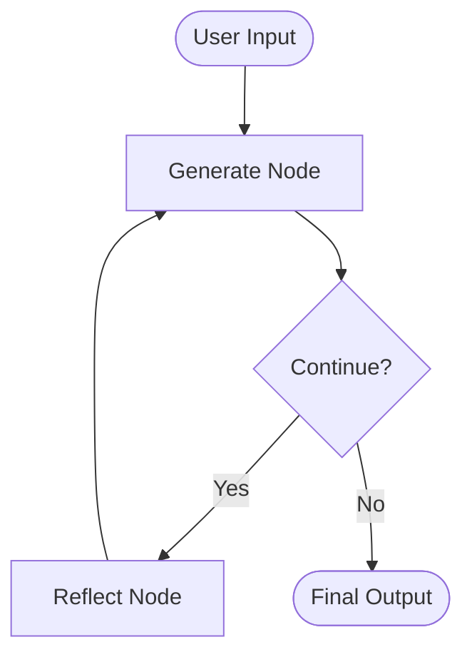

# LangGraph Agents – Reflection Agent

An AI-powered Twitter post improvement agent built using **LangChain and LangGraph**. This project demonstrates the Reflection pattern, where an LLM generates content, evaluates its output, and improves it iteratively based on feedback.

## 🚀 Project Overview

The Reflection Agent follows an iterative feedback loop to improve the quality of generated Twitter posts.

Instead of generating content just once, the agent uses two LLM-powered components:

- **Generator:** Creates a Twitter post based on the user's input.
- **Reflector:** Evaluates the generated post and provides constructive feedback on style, clarity, engagement, length, and virality.

The generator then uses this feedback to produce an improved version.

## 🏗️ Architecture



## ⚙️ Tech Stack

- Python
- LangChain
- LangGraph
- OpenAI API
- UV – Python package and environment management
- python-dotenv – Environment variable management

## 📂 Project Structure

```text
reflection-agent/
│
├── chains.py          # LLM prompts and chains
├── main.py            # LangGraph workflow
├── .env               # API credentials (not committed)
├── .gitignore
├── pyproject.toml     # Project dependencies
├── uv.lock
└── README.md
```

## 🛠️ Installation and Setup

### 1. Clone the repository

```bash
git clone -b reflection-agent https://github.com/Katla-Adithya/langgraph-agents.git

cd langgraph-agents
```

### 2. Create virtual environment

```bash
uv sync
```

### 3. Configure API Key

Create a `.env` file in the project root:

```env
OPENAI_API_KEY=your_openai_api_key
```

### 4. Run the application

```bash
uv run python main.py
```

## 🔄 Workflow

1. User provides a Twitter post or content idea.
2. The Generate node creates an initial version.
3. The Reflect node critiques the generated content.
4. Feedback is passed back to the Generate node.
5. The process repeats until the stopping condition is reached.
6. The final improved post is returned.

## 🎯 Learning Objectives

- Understanding LangGraph StateGraph.
- Working with shared state using TypedDict.
- Understanding message management with `add_messages`.
- Implementing conditional edges.
- Building iterative LLM workflows.
- Understanding the Reflection Agent design pattern.

## 👨‍💻 Author

**Adithya Katla**

GitHub: https://github.com/Katla-Adithya
